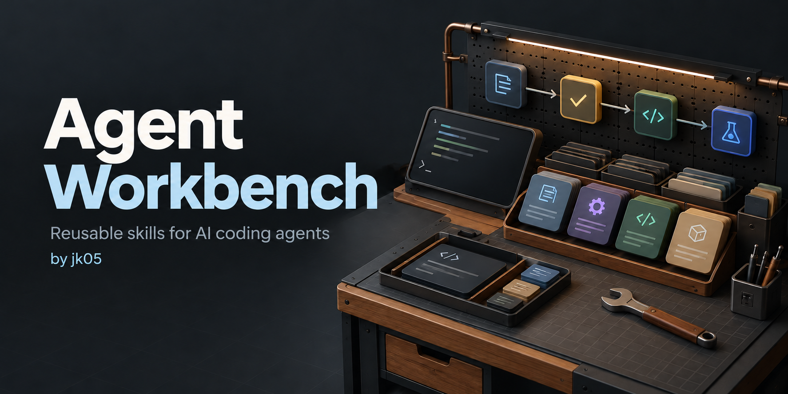

# Agent Workbench



Reusable skills and small helpers for working with AI coding agents.
**Copilot in VS Code's Agents window is the only supported target today.**

Why: keep your working preferences in one place, instead of repeating them
in every project. **Engineering Workbench is the first skill, not a limit
on what this repo can contain.**

Skills use the open [Agent Skills format](https://agentskills.io/home):
a folder with `SKILL.md` instructions and optional supporting files.
The format is portable; installation and runtime behavior still need checking
for each agent.

```text
THIS REPO                          YOUR PERSONAL SKILLS
Skills + helper + checks           ~/.agents/skills/<selected-skill>/
              -- approved install -->
                                            |
                                   Copilot reads the skill
                                            v
                                 YOUR PROJECT
                                 Skill + project rules + tools
                                            |
                                 Plan -> approve -> build/test
                                            |
                                 Approved PR -> CI / feedback
```

## Use it

Requires Python 3.9+ and Copilot in VS Code. No SDK or Node setup is needed
to verify or install.

1. Clone the repo and check readiness (no installation or AI calls):

   ```sh
   git clone https://github.com/jk05/agent-workbench.git
   cd agent-workbench
   python3 scripts/workbench.py verify engineering-workbench
   ```

   Expected: `required eval evidence is current and passing`.
   Verification reads saved [evals](evals/README.md); it does not rerun them.

2. Install **only after approving activation**:

   ```sh
   python3 scripts/workbench.py install engineering-workbench --activate
   ```

3. Open your project and start a fresh Copilot Agents session.
4. Ask, for example:

   > Use engineering-workbench to investigate PE-1234. Plan only for now.

The helper copies files; Copilot does the work. Installation does not set up
MCP servers, edit your project, or replace existing customizations.

**Status:** no user-wide installation has been performed. Workspace invocation
was observed; live Jira/PR delivery has not been tested.

<details>
<summary>Understand, maintain, and extend</summary>

- [Usage](docs/USAGE.md): select skills, update/remove, and save handoffs.
- [Why this design](docs/PROJECT-INTENT.md): ownership and future boundaries.
- [Copilot discovery](docs/copilot-discovery.md): why this install path works.
- [Tests](tests/README.md): check that the helper handles files safely.
- [Evals](evals/README.md): judge agent responses to fictional tasks.

```sh
python3 scripts/workbench.py --help
python3 scripts/workbench.py status
python3 -m unittest discover -s tests -v
npx --yes markdownlint-cli2@0.23.3 "**/*.md"
```

Other runtimes, such as Claude Code, could be added after verifying their
discovery and permissions. Selecting a Claude *model in Copilot* still uses
Copilot; it does not require another installer.

</details>
